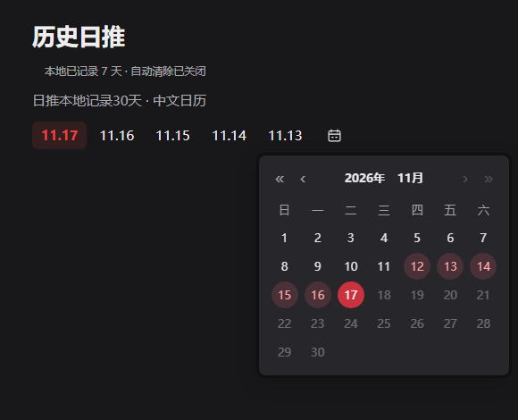

# NCM-daily-recommend-history

「日推本地记录30天」是一个 BetterNCM 插件，用于保存网易云音乐的每日推荐，并在客户端原有的「历史日推」页面按日期回看。当前版本为 **2.2**。

## 功能

- 打开「每日推荐」后记录当天的歌曲列表。打开「历史日推」时，补存官方列表中最近五个符合保留设置的日期。
- 日期栏显示最近五个可查看的日期。点击日历图标可选其他日期，点顶部年份或月份可打开中文网格选单。已保存日期用浅红圆圈标记，选中日期用实红圆圈标记。
- 默认自动保留最近 30 天。插件设置中可以调整保留天数、关闭自动清除、展开已保存日期及导出 JSON 备份。
- 歌曲元数据按账号保存在本机，回看与播放使用网易云音乐原有的歌曲列表和播放功能。

## 安装

适配 Windows 版网易云音乐 3.1.42，要求 [BetterNCM 1.3.3 或以上](https://github.com/std-microblock/chromatic/tree/v2)。清单允许 3.1.42 至 3.2.0 之前的 3.1 版本尝试加载。

1. [下载 2.2 插件包（.plugin）](https://github.com/Etern17y-maker/NCM-daily-recommend-history/releases/download/2.2/daily-recommend-history-30-2.2.plugin)。也可以在 [Releases](https://github.com/Etern17y-maker/NCM-daily-recommend-history/releases/tag/2.2) 查看该版本。
2. 完全退出网易云音乐，将插件包放入 BetterNCM 的 plugins 目录，默认路径为 C:\betterncm\plugins。升级时移出同一插件的旧包。
3. 重新打开网易云音乐，进入「历史日推」，点击日期栏右侧的日历图标。

重新启用自动清除或缩短保留天数时，超期记录可能立即被清除。需要留存的记录可以先在插件设置中导出。

## 构建与测试

需要 Node.js 及 Python 3，无第三方运行依赖。克隆仓库后运行以下命令。

~~~powershell
node --test tests/*.test.js
node scripts/build.js
python scripts/package.py --output release
~~~

插件包和源码归档生成在 release 目录。2.2 已通过自动化测试、模拟页面交互测试和隔离的原生数据模型验证。

## BetterNCM 插件商店

插件库同步 `plugin/` 中的清单、构建产物和预览图。改动源码后，运行 `node scripts/build.js`，然后将 `dist/main.js` 和 `dist/manifest.json` 复制到 `plugin/`，与源码一起提交。

## 上游与许可证

本项目是 BetterNCM 的独立第三方插件。查看 [BetterNCM 组织仓库](https://github.com/orgs/BetterNCM/repositories?type=all) 和 [BetterNCM 插件框架](https://github.com/BetterNCM/js-framework)。

使用 [MIT 许可证](LICENSE)。

